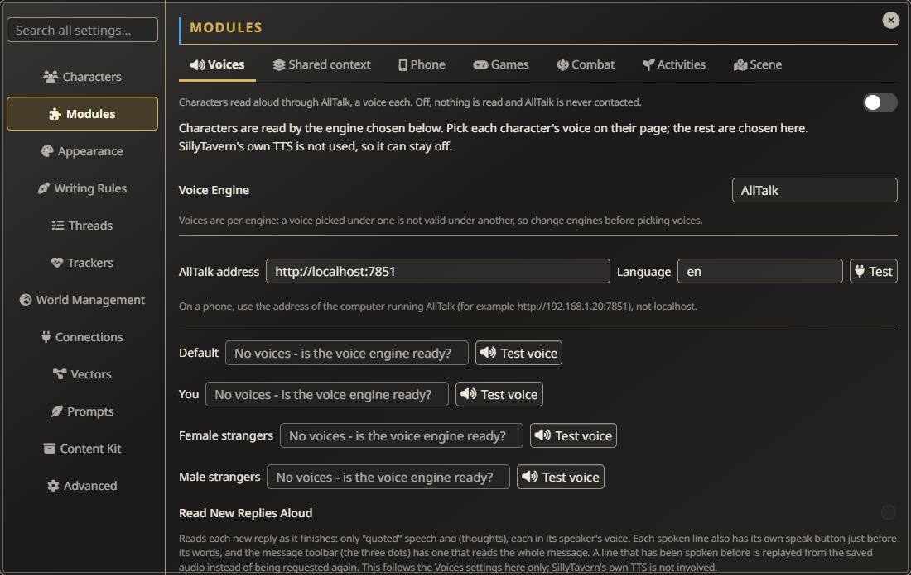
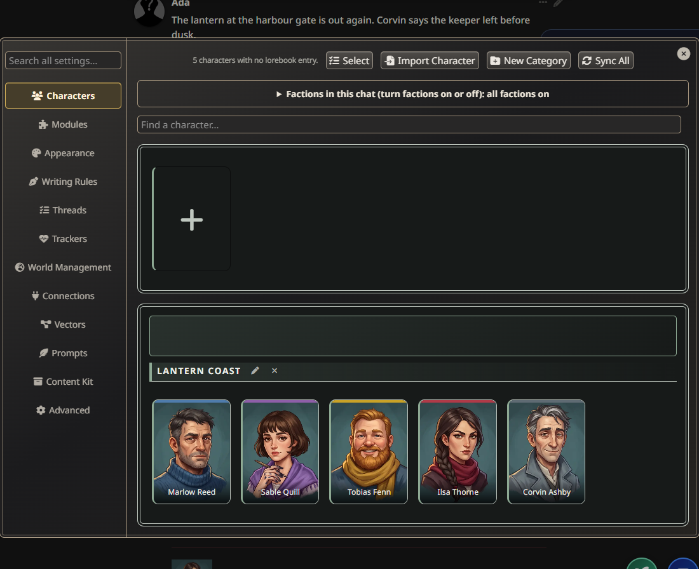
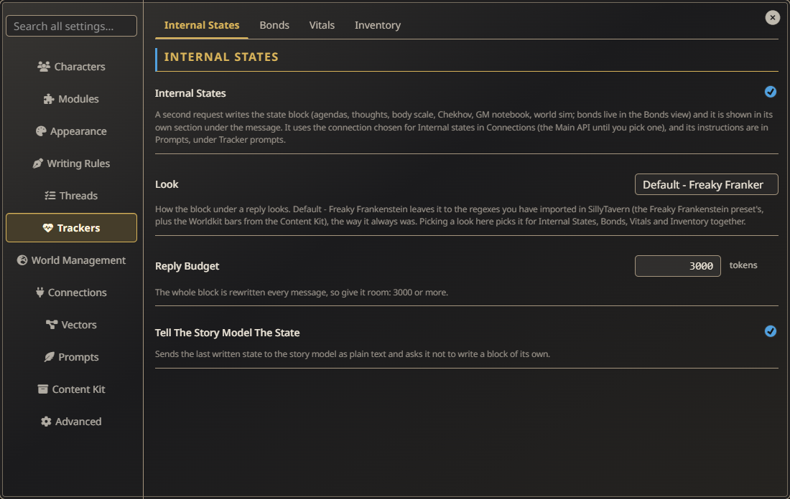
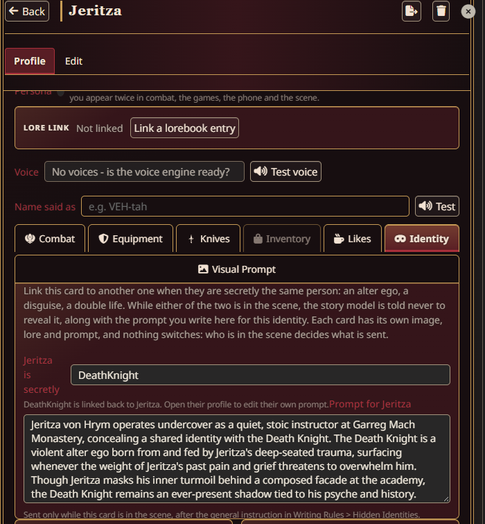
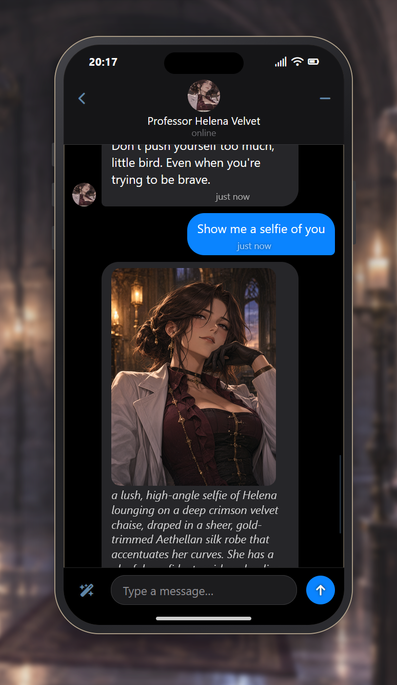
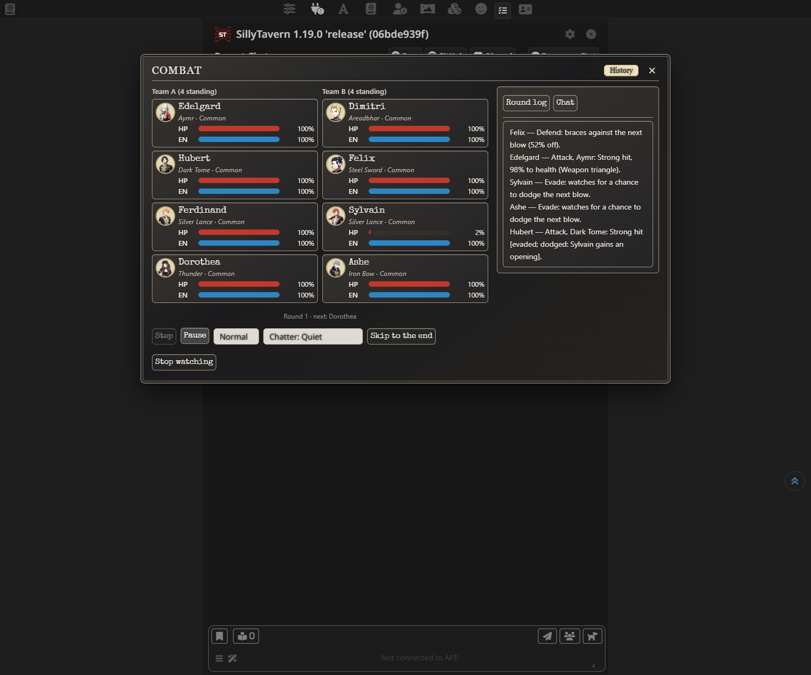

  

# Worldkit

Worldkit is a SillyTavern extension that makes a story feel like a living world. Every speaker gets a portrait and a colour. Worldkit keeps track of how people feel and what they carry, and adds a phone, table games, fights, a map of places and things to do together, all in one menu.

Most parts are off until you switch them on, so you can start small.

> **Beta.** **Activities** is not finished (some tiles say "Coming soon"), and **mobile** works but is in beta, with a proper optimization pass planned. See [Activities](docs/ACTIVITIES.md) and [how to report a bug](docs/REPORTING-BUGS.md).

## Why it exists

Almost no SillyTavern extension works well with **narrator cards**, where one character speaks for a whole cast. Worldkit reads who is speaking inside a reply (`⟦Name⟧ "line"` or `[[Name]] "line"`) and treats each person as their own character, so what other extensions do for one card can work for everyone in your story.

## Features

**Core** (each has its own switch)

- **Character stylist:** portraits, colours or gradients, and dividers for every speaker, with steady fallback faces for people without a card.
- **Characters and worlds:** a roster sorted into worlds and factions, profile pages, import and export.
- **Trackers:** Internal States, Bonds, Vitals and Inventory, shown under each reply, with several ready-made looks. Plus **Threads** for open promises and secrets.
- **Character disguises (hidden identities):** link two characters as one secret person, such as an alter ego or a double life. Each keeps their own portrait, lore and sheet. While either is in the scene, the model is told never to reveal the link, together with a prompt you wrote for that identity, and you can list who already knows the truth. Set it up on a character's **Identity** tab. See the [guide](docs/USER-GUIDE.md#hidden-identities-secret-alter-egos-and-disguises).
- **Writing rules and delivery tags:** dialogue format, a ban list, and tags for how a line is said (whispered, shouted).
- **Voices and sound effects:** lines read aloud with AllTalk or ElevenLabs (with emotion tags), and tappable sound chips.
- **Vectors:** optional search through older parts of the story.
- **Content Kit:** download and import worlds, packs, looks, sounds and more from the [content pack](docs/CONTENT-PACK.md).

**Modules** (each has its own switch in Modules)

| Module | What it does |
| :--- | :--- |
| **Phone** | Characters text you, send selfies and voice notes, and start conversations. Ships with ComfyUI workflows in the content pack. |
| **Games** | Chess, 21, poker, whist, battleship and more, played against your characters. |
| **Combat** | Duels by the rules of a world type. Presets for Fire Emblem, Bleach and Black Clover, or build your own. |
| **Scene** | A map of places with backgrounds, and weather over the chat. |
| **Activities** (beta) | Tea, cooking, fishing, gardening, crafting and study. See [Activities](docs/ACTIVITIES.md). |

## Install

1. In SillyTavern, open **Extensions**, then **Install extension**.
2. Paste `https://github.com/JasperCatStudios/WorldKit` and install.
3. Reload SillyTavern, then open **Extensions, Worldkit, Manage Worldkit**.

Or clone it by hand into `SillyTavern/public/scripts/extensions/third-party`.

## Documentation

| | |
| :--- | :--- |
| [User guide](docs/USER-GUIDE.md) | Every tab and feature, step by step |
| [Activities](docs/ACTIVITIES.md) | What works in the beta, and its settings |
| [Content pack](docs/CONTENT-PACK.md) | The optional Worldkit-Content repository |
| [Make an activity](docs/MAKE-AN-ACTIVITY.md) · [Art and sounds](docs/ASSETS-README.md) | Customize Activities |
| [World builder agent](docs/WORLD-BUILDER-AGENT.md) | Have an AI agent build a world from wiki pages |
| [Report a bug](docs/REPORTING-BUGS.md) | What to include, and how to get the logs |
| [Development](docs/DEVELOPMENT.md) | Layout of the code |

## Credits

Worldkit would not exist without these people. Thank you.

- **BrutalKoala** for [SillyNPC](https://github.com/BrutalKoala/SillyNPC), which Worldkit began as a fork of.
- **Arkana8** for the Phone and Games code ([RPG-Phone](https://github.com/tavern-rpg-suite/RPG-Phone), [RPG-Game-Companion](https://github.com/tavern-rpg-suite/RPG-Game-Companion)).
- **dptgreg** for the Internal States idea (FreakyFrankenstein).
- **Kritblade** for the vector strategy behind Vectors.
- **ZapoVerde** for Vistalyze, which Scene builds on.
- **DangerDaza** and **Marinara** for the weather effects ([Doom's Enhancement Suite](https://github.com/DangerDaza/Dooms-Enhancement-Suite), RPG Companion) and the character Knives.
- **Pyrxpia** for Tonal Typography.
- **Pixaroma** for the ComfyUI workflows.
- **mattjaybe** for [EchoText](https://github.com/mattjaybe/SillyTavern-EchoText), which the Phone's pictures were adapted from.
- **Jeff Hlywa** for [chess.js](https://github.com/jhlywa/chess.js), and the **Dialogue Colors** extension for the gradient model.

## License

**AGPL-3.0.** See [LICENSE](LICENSE). Third-party notices are in [licenses/](licenses/NOTICE.md).
