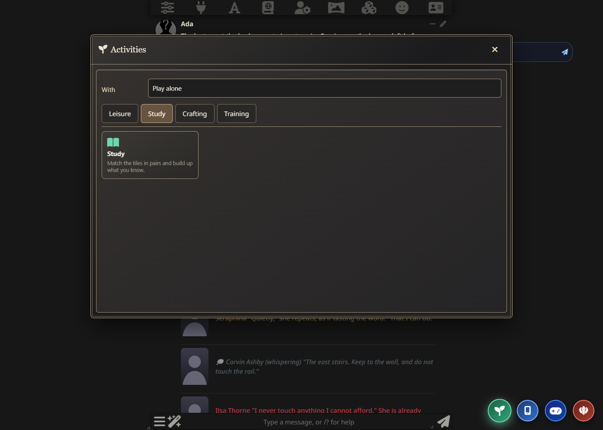
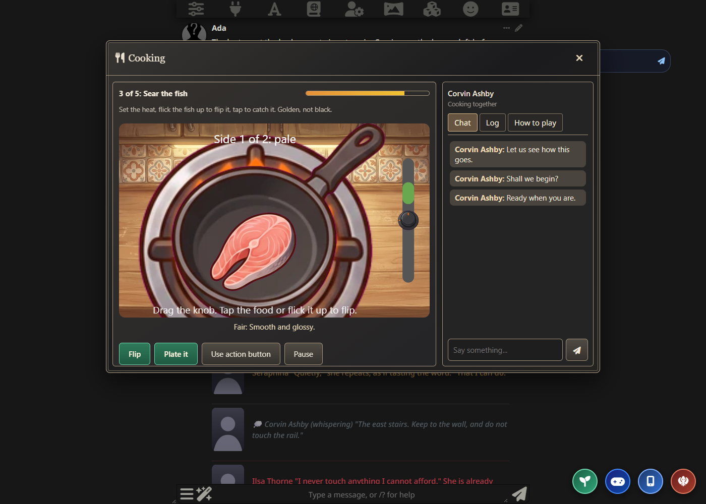

# Activities (beta)

> **Beta, not complete.** Activities is the newest part of Worldkit. It is switched on by default, and you can turn the whole thing off, button included, with **Activities on** in **Modules, Activities**. Some tiles say "Coming soon". More is planned with no dates promised. Expect changes, and please [report what you find](REPORTING-BUGS.md).

Activities is a hub (the green floating button) of things to do with a character, or alone. Finished activities can earn skill XP, cost a little energy and nudge a bond.

## Working today

- **Tea Time:** host a character at a table. Pick a tea, steep it and pour it in the right moment, offer a plate, and talk in the chat. The guest reacts to the tea, the food and the talk.
- **Cooking:** a hands-on kitchen with mini-games for chopping, stirring, searing, seasoning, pouring and plating. A simpler three-tap version can be switched on. An optional **Share a Meal** step serves the dish to a character.
- **Fishing and Gardening:** wait for a bite and reel it in, or plant and tend beds over several days.
- **Crafting:** alchemy and smithing, where you pick materials and play through a few stages.
- **Study:** a matching-pairs game with three board sizes and three difficulties.
- **Your own activities:** add a small activity file of your own. See [MAKE-AN-ACTIVITY.md](MAKE-AN-ACTIVITY.md).
- **Customize:** a world can rename activities and terms and change items, so the hub fits your story. Art and sounds are listed in [ASSETS-README.md](ASSETS-README.md).

## Not built yet

The **Training** tab (drills) and exam activities show as "Coming soon" if a world lists them.

## Settings

The pane in **Modules, Activities** is grouped into **General**, **Table talk and the model**, **How the games play**, **Skills and energy** and **Music and sound**.

- Energy cost only works while the Vitals tracker is on and tracks energy. Bond nudges only matter while Bonds is on.
- The sound map address points at a sound map file of your own. An example with one sound is in [examples/sound-map-example.json](examples/sound-map-example.json). A missing file is silent.

More detail is in the [user guide](USER-GUIDE.md#activities-beta).
