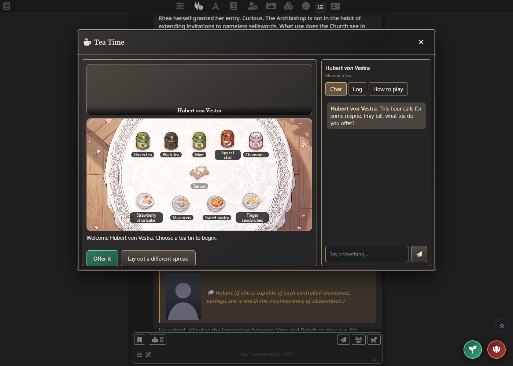

# Activities (beta)

> **Beta, not complete.** Activities is the newest part of Worldkit. It is switched on by default, and you can turn the whole thing off, button included, with **Activities on** in **Modules, Activities**. Some tiles say "Coming soon". More is planned with no dates promised. Expect changes, and please [report what you find](REPORTING-BUGS.md).

Activities is a hub (the green floating button) of things to do with a character, or alone. Finished activities can earn skill XP, cost a little energy and nudge a bond.

## Working today

- **Tea Time:** host a character at a table. Pick a tea, steep it and pour it in the right moment, offer a plate, and talk in the chat. The guest reacts to the tea, the food and the talk.
- **Cooking:** a hands-on kitchen with mini-games for chopping, stirring, searing, seasoning, pouring and plating. A simpler three-tap version can be switched on. An optional **Share a Meal** step serves the dish to a character.
- **Fishing and Gardening:** wait for a bite and reel it in, or plant and tend beds over several days.
- **Crafting:** alchemy and smithing, where you pick materials and play through a few stages.
- **Study:** a matching-pairs game with three board sizes and three difficulties.
- **Training drills:** short, repeatable practice for one skill. A mark crosses a lane and you tap when it is in the ring. Drills are data, so a world can add its own. Phones get a wider ring and a slower mark.
- **Certification exam:** a graded set of drills for a skill's next rank. Pass every test to raise the skill by one rank and earn a credential (a seal, a badge, whatever the world calls it). Which credential depends on where the new rank sits on the skill's ladder. See [Who can examine](#who-can-examine) below.
- **Your own activities:** add a small activity file of your own. See [MAKE-AN-ACTIVITY.md](MAKE-AN-ACTIVITY.md).
- **Customize:** a world can rename activities and terms and change items, so the hub fits your story. Art and sounds are listed in [ASSETS-README.md](ASSETS-README.md).

## Not built yet

More drill kinds (a flying run, a riding course, spell chains, triage) are planned. Today there is one drill kind, a tap-when-it-is-in-the-ring test.

## The certification exam

The exam is for the **next rank** of one skill. It is a short run of drills, each harder than the last, and every test needs a share of the points. The first test you miss ends the exam. A pass raises the skill by one rank and gives the credential. A fail gives only a little XP.

- **Ready first:** a skill must already hold about half of the XP toward its next rank, so train it before you sit the exam.
- **Attempts:** one attempt per skill per story day.
- **Which credential:** the skill's ladder is cut into equal parts, one per credential tier the world names. Low ranks give the lowest tier. A world can list its own tiers.

### Who can examine

A world decides who may set the exam. Under **Modules, Activities, Customize an activity, Wording, People and exams**, pick **Who may examine**:

- **Any partner:** whoever you picked in the hub examines you. This is the default.
- **Only characters with a tag:** type the tag (for example `mentor`) in **Examiner tag**. Then add that tag to each examiner on their Worldkit page, in the **Tags** box (comma separated, not case sensitive). Nobody else can examine.
- **Only someone who holds the skill at that rank:** the partner must already hold the skill at the rank you are testing for.

You do not have to create a special character for any of these.

## Debug mode

**Modules, Activities, Debug mode (testing)** turns off the limits so you can test: energy costs, needing a partner, who may examine, exam readiness and the daily attempt limit, and the once-a-day bond limit. Turn it off to play normally.

## Settings

The pane in **Modules, Activities** is grouped into **General**, **Table talk and the model**, **How the games play**, **Skills and energy** and **Music and sound**.

- Energy cost only works while the Vitals tracker is on and tracks energy. Bond nudges only matter while Bonds is on.
- The sound map address points at a sound map file of your own. An example with one sound is in [examples/sound-map-example.json](examples/sound-map-example.json). A missing file is silent.

More detail is in the [user guide](USER-GUIDE.md#activities-beta).
