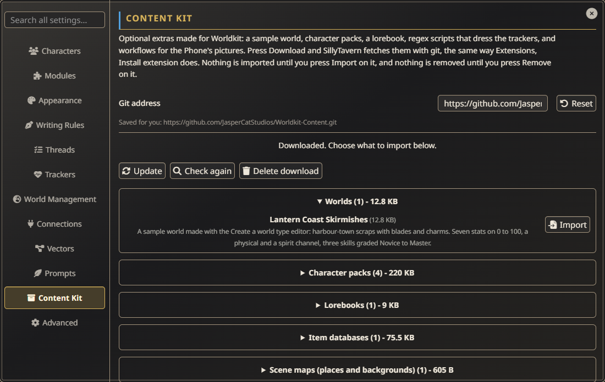

# Worldkit-Content: optional sample content

[Worldkit-Content](https://github.com/JasperCatStudios/Worldkit-Content) is a **separate repository** of extras to try with Worldkit. Worldkit never downloads it by itself and nothing depends on it.

## What is in it

- A sample world, **Lantern Coast Skirmishes**, with a lorebook and a small cast of invented characters.
- **Character packs** with combat sheets for the three built-in world types (Fire Emblem, Bleach, Black Clover) and the sample world. No portraits or lore, and the numbers are one fan's reading, so change them freely.
- **Item databases** for the Inventory.
- **Looks** for the tracker blocks, including three full looks.
- **Scene maps**, **sounds** (a common pack and a set for Activities) and **artwork**.
- **A simple preset, "Assistant".** A Chat Completion preset that stays out of the way, so the instructions each Worldkit module adds are the ones the model follows. Press **Import** on it in the Content Kit, reload SillyTavern, then pick it in the Chat Completion presets.
- **ComfyUI workflows** for the Phone's pictures: selfies from a character sheet, and a general text-to-image one. They need ComfyUI and some model files you download yourself.

## How to get it

1. *The easy way:* open the Worldkit menu, go to **Content Kit** and press **Download**. The address is filled in. Then press **Import** or **Copy** next to what you want. Press **Update** later for new content.
2. *By hand:* on the Worldkit-Content page, press **Code**, then **Download ZIP**, and unzip it outside SillyTavern's extensions folder.

Nothing is imported until you press a button, and nothing is deleted unless you press **Remove**.

Some of the artwork and the franchise packs are fan material, and the sounds were generated with the author's own accounts. Check the licence notes in that repository before you share them.

## Make your own world

An AI agent can build a world from wiki pages you save. See [WORLD-BUILDER-AGENT.md](WORLD-BUILDER-AGENT.md).
