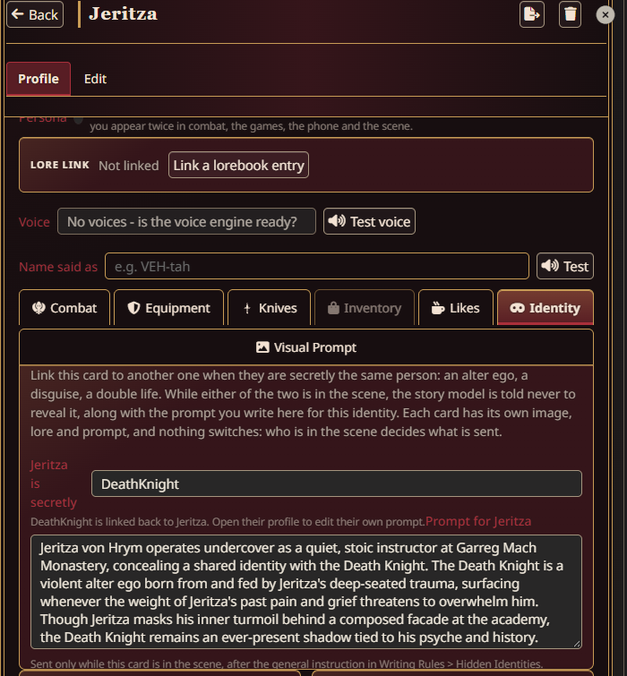
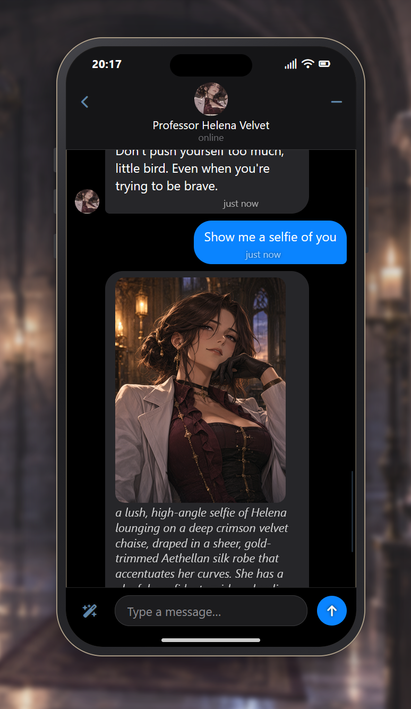
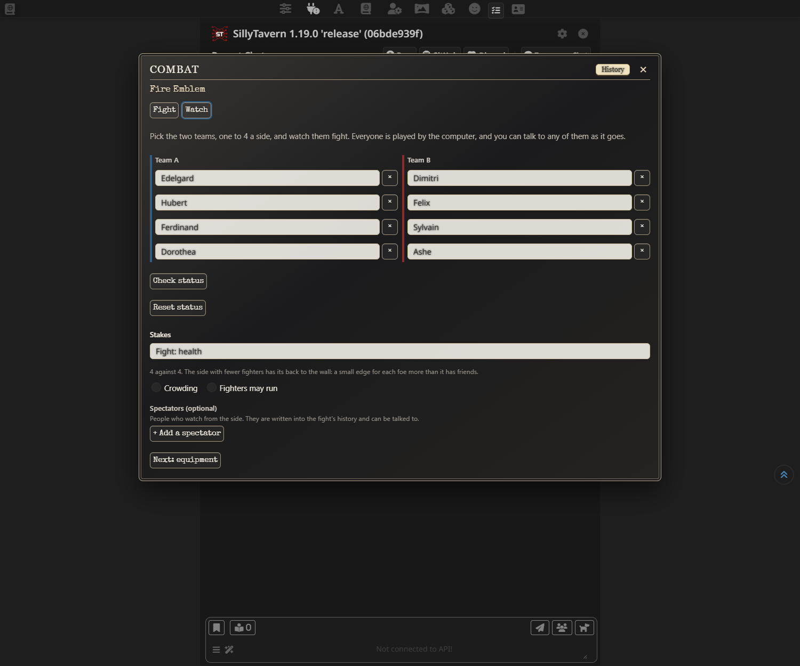
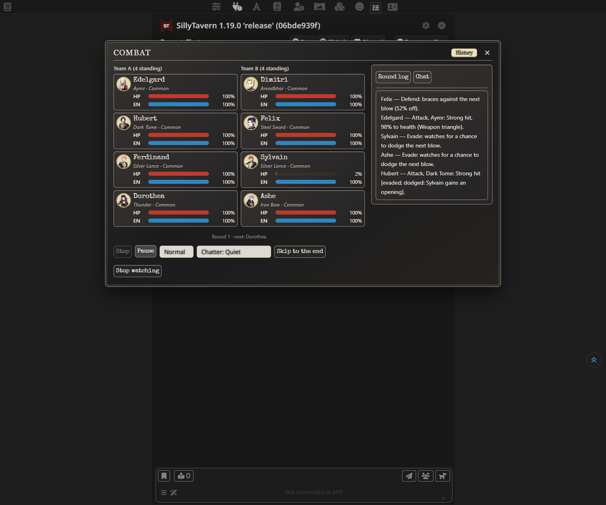
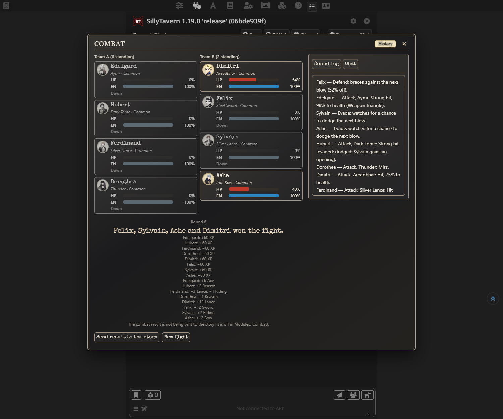
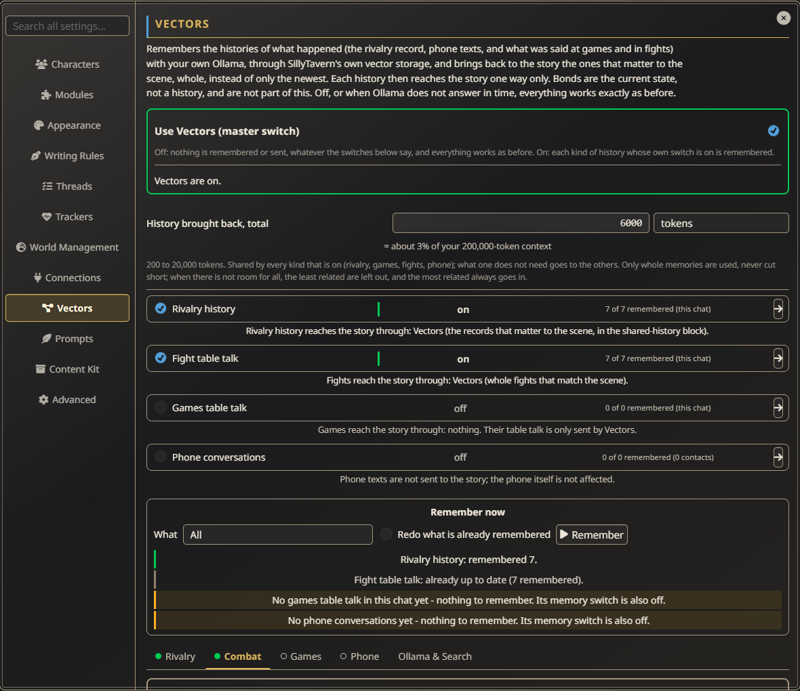
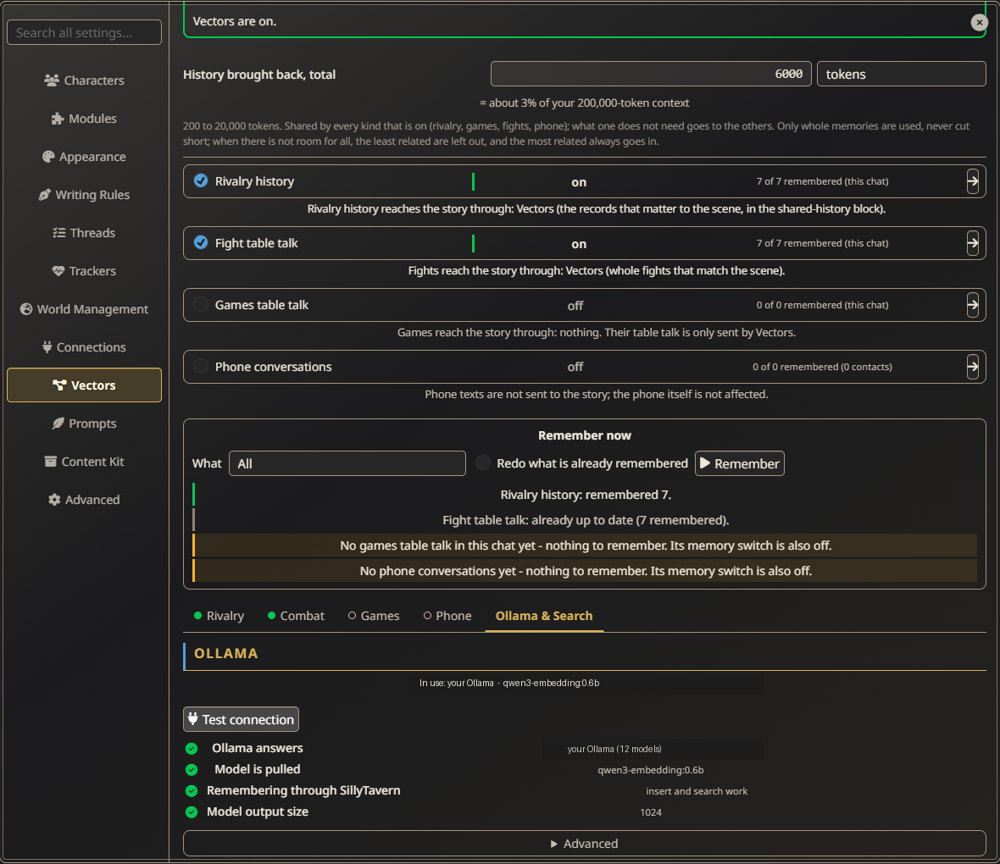

# Worldkit User Guide

Worldkit is an extension for SillyTavern, the program you use for roleplay chats with an AI.

Worldkit makes a chat feel like a living world. Characters get their own portraits and coloured speech. Small hidden helpers, called **trackers**, read each reply and keep notes on feelings, relationships, health and belongings. A phone lets you text characters, there are table games, and there is a combat system. Almost everything is optional, and most of it is switched off until you turn it on.

---

## Table of contents

1. [How to read this guide](#how-to-read-this-guide)
2. [Getting started](#getting-started)
3. [Characters and dialogue](#characters-and-dialogue)
4. [World Management](#world-management)
5. [Trackers](#trackers)
   - [What a tracker is](#what-a-tracker-is)
   - [Internal States](#internal-states)
   - [Bonds](#bonds)
   - [Vitals](#vitals)
   - [Inventory](#inventory)
   - [Open Threads](#open-threads)
   - [Looks](#looks)
6. [Slash commands](#slash-commands)
   - [Chocolate chip cookie tutorial](#chocolate-chip-cookie-tutorial)
   - [Gold commands](#gold-commands)
   - [Phone commands](#phone-commands)
7. [Phone](#phone)
8. [Games](#games)
9. [Combat](#combat)
10. [Scene](#scene)
11. [Prompts tab](#prompts-tab)
12. [Connections tab](#connections-tab)
13. [Vectors](#vectors)
14. [Writing Rules](#writing-rules)
15. [Appearance](#appearance)
16. [Content Kit](#content-kit)
17. [Activities (beta)](#activities-beta)
18. [Advanced](#advanced)
19. [Troubleshooting](#troubleshooting)
20. [Credits and licences](#credits-and-licences)
21. [Where to get help](#where-to-get-help)

---

## How to read this guide

- **Bold** text is a name you will see on a menu or button.
- `Code` text is something you type, such as a command.
- Each feature has the same parts: what it is, why you might want it, how to turn it on, how to use it, what you will see, what the settings do, and tips.

A few words used throughout:

- **Chat**: one conversation with a character in SillyTavern.
- **Model**: the AI that writes replies.
- **Connection profile**: a saved choice of which AI service a helper should use. More on this in the [Connections tab](#connections-tab) section.
- **Prompt**: the instructions Worldkit sends to a model. More on this in the [Prompts tab](#prompts-tab) section.
- **Regex**: a pattern for finding text. You do not need to write any to use Worldkit. Worldkit's own looks are built on them.
- **JSON**: a structured text format. Some helpers ask the model to answer in it. You will never need to write it.

---

## Getting started

### What is on by default

Most of Worldkit is off until you switch it on. In the code, the main switch for the whole extension is on by default. Individual features are off by default, including:

- the **Inventory** tracker (its master switch is off by default);
- **Open Threads** (off by default);
- the **Phone**, **Games** and **Combat** modules;
- **Vectors** (its master switch, see the [Vectors](#vectors) section, off by default);
- **Bonds Fade With Time Apart** (off by default).

The main dialogue formatting setting, **Ask The Model To Format Dialogue**, is on by default. This is what makes Worldkit recognise who is speaking. Turning it on or off is covered in the [Writing Rules](#writing-rules) section.

### Where the Worldkit menu is

1. Look for the **Extensions** button in SillyTavern. It looks like a stack of blocks.
2. Find the Worldkit entry in the list.
3. Open it. A menu with tabs opens. The menu is searchable: there is a search box above each page, so you can type a setting's name instead of hunting for it.

Worldkit also adds a few buttons to the chat area: a **wand menu** entry (the magic wand button in the chat bar) with entries for the games, combat and phone windows, and floating buttons for those windows.

### The tabs

The menu has these tabs, in this order:

| Tab | What it is for |
| --- | --- |
| **Characters** | Your character cards, portraits, colours, gradients, factions and categories. |
| **Modules** | Turns the Phone, Games, Combat, Activities and Scene modules on or off, and holds the Voices settings and the shared context settings. |
| **Appearance** | How speech looks: dividers, spacing, avatar shapes and sizes, and the faces used for strangers. |
| **Writing Rules** | How Worldkit reads speaker names and the dialogue format, and the ban list. |
| **Threads** | Open Threads: promises, debts, secrets and similar things that are still unresolved. |
| **Trackers** | Internal States, Bonds, Vitals and Inventory. |
| **World Management** | Your worlds, saved states, and import and export. |
| **Connections** | Which AI connection each helper uses. |
| **Vectors** | Optional memory search over the story. |
| **Prompts** | Every instruction Worldkit sends to a model, and what each costs. |
| **Content Kit** | Download the Worldkit-Content repository, import pieces of it, and remove them again. |
| **Advanced** | The master switch, logging, backups, and the menu's size. |

### What the Look, Connections and Prompts tabs are for

- **Look**: how the trackers are drawn. It is a choice near the top of the Internal States, Bonds, Vitals and Inventory pages, and one choice applies to all four. See [Looks](#looks).
- **Connections**: which AI connection each helper uses. Leave an entry on **Main API (same as chat)** and the helper uses the connection you are already chatting with. See [Connections tab](#connections-tab).
- **Prompts**: the text Worldkit sends to a model. You can read it, change it, or go back to the built-in text. See [Prompts tab](#prompts-tab).

### A first setup in five steps

1. Open the Worldkit menu and go to **Writing Rules**. Check that **Ask The Model To Format Dialogue** is on.
2. Go to **Characters**. Open a character who speaks in the chat and give them a card (see [Characters and dialogue](#characters-and-dialogue)).
3. Send a message and check that the speaker's name now has a portrait and coloured speech.
4. Only then switch on a tracker. Start with one, such as **Internal States**.
5. Go to **Connections** and choose a connection for that tracker, or leave it on **Main API**.

---

## Characters and dialogue

### What it is

Worldkit reads the speaker name at the start of each line of a reply and draws the speaker with a portrait, a coloured speech block and a divider. Characters with a card get their own look. Speakers without a card get an automatic colour and a face from a pool.

### Why you might want it

It makes a group scene easy to follow at a glance, because each speaker has a distinct colour and face.

### Turn it on

1. Open the Worldkit menu and go to **Writing Rules**.
2. Make sure **Ask The Model To Format Dialogue** is on.
3. Speaker detection is set under **Speaker Detection** on the same page (see [Writing Rules](#writing-rules)).

### How to use it

1. Send a message in a chat. Wait for the reply.
2. Look at the speaker's name in the reply. If the reply uses the speaker format Worldkit asks for, the line is recognised.
3. Click the speaker's name or portrait in the chat. What happens depends on the speaker:
   - If you click **your own portrait**, your player sheet opens.
   - If the speaker has a **card**, the character editor opens.
   - If the speaker has **no card**, you are asked whether to **create a character card**. Alternatively, you can link the name to a character that already exists (this is called an **alias**).
4. In the character editor, you can upload a portrait image, choose an accent colour, and save.
5. Go to **Characters** to see every character, sort them into categories, and edit their details.

### What you will see

- A portrait beside each speaker's lines.
- A coloured speech block (the colour depends on your settings).
- A divider between blocks of speech.
- For speakers with no card, an automatic colour and a face from the stranger pool.

### Settings explained

These are on the **Characters** tab and the **Appearance** tab. Where a setting is on another tab, it is noted.

- **Image fit**: **Show full image** keeps the whole picture. **Fill avatar (crop)** fills the frame and crops the edges.
- **Speech color**: the colour used for the character's dialogue.
- **Advanced colors**: **Dialogue text**, **Border accent** and **Background highlight**, each set separately.
- **Name patterns (aliases)**: other names this character may be called in the chat. There is a **Regex** checkbox that makes an alias use a pattern instead of plain text. Use this sparingly.
- **Faces for Strangers**: see the sub-section below.
- **Colour Speakers Without A Card** (on **Appearance**): colours speakers that have no card.
- **Hide Default Speaker Names** (on **Appearance**): hides the plain name at the start of the line, so only the styled block shows.

#### Dialogue gradients

A gradient paints a character's dialogue text with more than one colour.

- In the character editor, open the gradient editor for that character.
- Choose a shape: linear, radial or conic.
- Choose 2 to 5 colour stops. There are 15 presets to start from.
- Optionally turn on a slow drift, so the colours move.

The gradient model is adapted from the Dialogue Colors extension, which is MIT licensed (see [Credits and licences](#credits-and-licences)).

#### Factions

A faction is a group, such as a guild or a house. Characters in a faction take the faction's colours. Factions are grouped by world.

- Use the **Factions in this chat** panel on the **Characters** tab to turn factions on or off for the current chat.
- Hidden factions are not applied to the chat.

#### Roster categories

Categories sort characters into groups such as worlds, factions or scenes. You can limit a chat to only the categories it needs.

- On the **Characters** tab, use **New Category** to make a category.
- Drag characters into a category, or use the bulk selection to move several at once.
- **Sync All** looks through your lorebooks for an entry matching each character that is not linked yet (by name, alias or keyword), links the ones it finds and says how many. It is greyed out when nothing needs linking.

#### Import and export of characters

- **Import Character** brings in a character card.
- Select characters and use **Export selected** to save them as a file. Portraits and lorebook entries travel with the card.
- Keep character files private if they contain characters you have made for your own use.

#### Lorebook links

A lorebook is a set of notes SillyTavern can draw on. You can link a character to a lorebook entry. Worldkit then reads who the character is from that entry.

#### Faces for Strangers

When a speaker has no card, Worldkit draws a face from a pool of portraits.

1. Go to **Appearance** and find **Faces For Strangers**.
2. Click **Add faces** and choose images.
3. Give each face a **tag** (for example, `guard`). A guard then draws from the guard faces.
4. Set **Gender** to **unsorted**, **female** or **male**.
5. Remove a face with its **X** button.

Settings:

- **A Stranger Is Somebody New After**: how many messages must pass before a stranger is treated as a new person and given a new face. The default is 12.
- **Redraw every face in this chat**: picks new faces for every stranger in the chat.

A stranger keeps the same face for as long as they keep appearing.

### Tips and gotchas

- If a chat is not being decorated, check that **Ask The Model To Format Dialogue** is still on. A persona or preset that asks the model for a different layout is the usual cause.
- Speakers are only recognised when the reply uses the speaker format. A reply in a different layout is not decorated.
- Importing a character can replace existing data if you choose a full backup. Read the confirmation carefully (see [Advanced](#advanced)).

---

## World Management

### What it is

A **world** is a saved set of characters and settings for one story or setting. You can keep several worlds, switch between them, save the state of a world at a point in time, and move worlds in and out of files.

### Why you might want it

If you play in more than one setting, a world keeps each one separate, so a fantasy cast does not spill into a modern one.

### Turn it on

Worldkit's worlds are always available. Open the Worldkit menu and go to **World Management**.

### How to use it

**Switching worlds**

1. Go to **World Management**.
2. In the list of worlds, click the radio button beside the world you want. The world marked **(in use)** is the current one.

**Creating a world**

1. Click **New World**.
2. Give it a name. The new world starts from the defaults with nobody in it.
3. Add characters to it from the **Characters** tab.

**Setting a default world (the star button)**

1. In the world list, click the **star** button beside a world.
2. That world is now marked **(default)**. It will open every time SillyTavern starts.
3. Click the star again to clear the default.

**Saving a state**

1. Scroll to the section headed **Saved states of "<name>"**.
2. Click **Save state now**.
3. Worldkit writes the state to a file in your SillyTavern user files folder.

**Restoring a state**

1. In the **Saved states** section, find the state you want.
2. Click **Restore**.
3. Confirm with **Restore this saved state?**.
4. Worldkit saves the current state first, labelled **Before restore**, so you can go back.

**Exporting and importing a world**

1. To export, click the export button beside a world. It saves the world as a JSON file.
2. To import, click **Import JSON** and choose the file.
3. Importing a file that has no name, or is missing its settings, is refused.

**Deleting**

- Delete a world with its delete button. You cannot delete the world that is in use. Switch to another world first.
- Deleting a saved state removes it permanently.

### What you will see

- A table of worlds. Each row shows the world's name, how many characters it holds (for example, **Characters (4)**), and labels such as **(in use)** and **(default)**.
- A list of saved states under the world you chose.

### Settings explained

- **Automatic save interval (minutes)**: saves a state automatically at this interval. It is set to 0 (off) by default. Automatic saves are labelled **Automatic** and are silent.
- **Saved states kept**: how many states are kept. Older ones are removed when this number is passed. The default is 5.

Both of these are on the **World Management** page.

### Tips and gotchas

- Saved states are files. If you move your SillyTavern folder, keep the files with it.
- Deleting the world that is the default also clears the default.

---

## Trackers

### What a tracker is

A **tracker** is a small helper that reads each new reply and keeps notes. The notes appear in a section under the message, so you can see them without leaving the chat. The tracker's notes are also sent back to the story, so the model can keep them in mind.

Each tracker:

- is off until you switch it on;
- reads replies on a connection you choose (see [Connections tab](#connections-tab));
- keeps its notes **per chat**, so each chat has its own notes;
- has its own reader instructions, in the [Prompts tab](#prompts-tab).

There are five trackers: **Internal States**, **Bonds**, **Vitals**, **Inventory** and **Open Threads**. The **Look** choice changes how four of them are drawn.

### Turn on any tracker

1. Open the Worldkit menu and go to **Trackers** (or **Threads** for Open Threads).
2. Switch on the tracker's first switch, such as **Track Inventory** or **Track Bonds**.
3. If you want the tracker to read replies on its own, check **When ... Update** and choose a timing (see below).

---

### Internal States

**What it is.** Notes on what each character thinks and feels, written after each reply and shown in its own section under the message.

**Why you might want it.** It keeps characters' inner states consistent between scenes.

**Turn it on.** Open **Trackers**, then find the **Internal States** block. Switch on **Internal States** for the characters you want.

**How to use it.**

1. Open **Characters**, choose a character, and open the **Edit** tab.
2. Find the **Internal States** toggle and switch it on for that character.
3. Send a message. The reply's section under the message shows the character's states.
4. Set the connection for this tracker on the **Connections** tab, under **Internal states**.

**What you will see.** A section under each reply, listing each tracked character's current thoughts and feelings.

**Settings explained.**

- **Internal States** (toggle, per character): turns tracking on for that character.
- **Reply Budget**: how much the reader may write back, in tokens. A token is a small piece of text. The default is 3000.
- **Earlier Messages Read**: how many earlier messages the reader sees, for context.
- **Tell The Story Model The State**: if on, the states are also sent to the model that writes the reply.

The help text for the feature mentions agendas, thoughts, body scale, Chekhov (a plant that must pay off later), a GM notebook (a running record kept by a game master) and world simulation. Bonds are handled on their own page.

**Tips and gotchas.**

- Internal States are written after the reply (the default timing).
- If you turn off the tracker, nothing is read or changed, but the states already recorded are kept.

---

### Bonds

**What it is.** A record of how close each person is to you, with levels, rules about what each level allows, and milestones (moments that mark a change). The model can only propose changes; you can accept, edit or refuse them.

**Why you might want it.** It keeps relationships moving in a believable way and keeps romance from jumping ahead of the story.

**Turn it on.** Open **Trackers**, then the **Bond Tracker** page, and switch on **Track Bonds**. This is the master switch. If it is off, there are no requests, no changes, and nothing in the story prompt.

**How to use it.**

1. Open the **Bond Tracker** page under **Trackers**.
2. Under **Characters In This Chat**, search or add a person by name (**Add someone by name**). A person is not tracked until you switch tracking on for them.
3. Tick the people you want, then press **Track**. Press **Untrack** to stop, or **Untrack everyone** to stop for all.
4. Press the update button beside a person to read the newest reply for them now.
5. Expand a person's row to see their **history and milestones**. Use the **Record it now** options to record a milestone yourself.
6. Use the **Turn romance on** or **Keep platonic** buttons to set how the relationship may develop. Romance is off until you turn it on.
7. Set the bond's lock with its lock control. **Open** lets romance be switched on for either side. Other locks limit it.

**What you will see.** A list of characters with their level, meters (affection and trust are named in the help text), gates, and milestones. Each person's row has buttons to update, forget, or show history.

**Settings explained.**

- **Track Bonds**: the master switch.
- **When Bonds Update**: **After The Reply** runs a separate request on the Bonds connection after each new reply.
- **Reply Budget**: about how much the reader may write back. The reply is a small structured answer, and 800 is enough.
- **Earlier Messages Read**: messages before the new reply the reader is shown.
- **Bonds Fade With Time Apart** (in **Growth Rules**): people who are not seen for a while slowly drift back toward the floor. Off by default.
- **What Raises A Bond** and **What Lowers A Bond**: one item per line, each told to the model that proposes changes. The biggest drops are for what you list last.
- **Levels**: friendship levels and romance levels. Each level has a name and a description of how the character acts at that level. You can add levels, delete them, or reset them to the built-in levels.
- **Gates**: rules about what each level allows. Each gate has a kind, a level, and a scope (who must feel it). The scope "They may start it" lets the character start it alone. "Both must feel it" needs your side to be at the same level too.
- **Milestones**: named moments to record, such as "first kiss". You can add your own or restore the defaults. A milestone can be recorded automatically or by hand.
- **Send Bonds To The Story** (in **In The Story Prompt**): adds each chosen character's level, gates and milestones to the prompt the main model sees. An instruction line can be written here too. **{{user}}** is replaced with your name.
- **Preview**: shows what would be sent, ignoring the trigger and the dice.

**Tips and gotchas.**

- Milestones and bond changes are proposals from the reader, so check them.
- A bond can be reset by hand by clicking the meter and typing a value (between the lowest and highest limits).
- If you turn off a bond gate's level, the gates that used it move to the top level. The help text on the delete button says so.
- The bond history is kept per chat.

---

### Vitals

**What it is.** Health, hunger, energy and mood for the people you choose, shown with bars.

**Why you might want it.** It keeps wounds, hunger and tiredness consistent across a long story.

**Turn it on.** Open **Trackers** and the **Vitals** block. Switch on **Track Vitals**.

**How to use it.**

1. Switch on **Track Vitals**.
2. Choose when vitals update under **When Vitals Update**.
3. Choose whose vitals go into the story under **Send To The Story For**.
4. Switch **Include Your Persona** on if you want your own vitals tracked.
5. Set the connection for vitals under **Connections**, in the **Vitals** entry.
6. Send a message and check the bars under the reply.

**What you will see.** A small block with bars for health, hunger, energy and mood, for each tracked person.

**Settings explained.**

- **Track Vitals**: master switch.
- **When Vitals Update**: when the reader runs (the choices are not all verified; the timing used is the same kind as the other trackers, after the reply).
- **Include Your Persona**: whether your character is tracked.
- **Reply Budget**: about how much the reader may write back. 600 is enough.
- **Earlier Messages Read**: messages the reader is shown for context.
- **Send To The Story For**, **Prompt Position** and **Prompt Role**: where and how the vitals are placed in the story prompt. These are advanced settings. The **Prompt Role** is the role the message is sent as (for example, system).

**Tips and gotchas.**

- The reader's instructions are in the [Prompts tab](#prompts-tab), under **Tracker prompts**.
- Use **Preview** if you want to see what is sent to the story.

---

### Inventory

**What it is.** A record of what each person carries and how much money they have. Items and money are kept **per chat**.

**Why you might want it.** It stops items vanishing or appearing for no reason, and keeps your purse consistent.

**Turn it on.** Open **Trackers**, then the **Inventory Tracker** page. Switch on **Track Inventory**.

**How to use it.**

1. Switch on **Track Inventory**.
2. Under **When Inventory Updates**, choose **After The Reply** (a separate request reads each reply) or **Only When I Press Update** (nothing happens by itself).
3. Under **Who and what**, leave **Track Other Characters** off to track only you (the default). Turn it on to also keep packs for characters the reader knows from the scene.
4. Leave **Track Money** on to keep a purse. Type the name of the money in **Currency Name**. Examples are Gold, Credits, Crowns and Caps. The name can be up to 24 characters.
5. Under **Packs in this chat**, click **Start your own pack** if your pack has not appeared yet.
6. To add an item by hand, use the row at the bottom of a pack: type the **Item**, set the quantity, type a **Kind** (for example, Weapon or Tool), and click **Add**.
7. To remove a whole stack, click **Drop** beside it.
8. To set money by hand, type a number in the purse box beside a person's name.
9. Click **Read the latest reply now** to read the newest reply straight away.
10. To see exactly what is sent to the story, click **Preview what is sent**.

**What you will see.** A card for each pack. Each card shows the person's name (with **(you)** for you), the money, and a line for each item in this form:

`item name x quantity [kind] - note`

A person with nothing carries the message **Carrying nothing.**

**Settings explained.**

- **Track Inventory**: master switch. Off means no requests, no changes, and nothing sent to the story. Items already recorded are kept.
- **When Inventory Updates**: described in step 2 above.
- **Track Other Characters**: off by default. Only you are tracked until it is on.
- **Track Money**: keeps a purse.
- **Currency Name**: the name shown for money in the block, the story prompt and the reader.
- **Most Items Per Person** (advanced): the most items one person may carry. The default is 60.
- **Reply Budget** (advanced): about how much the reader may write back. 800 is enough.
- **Earlier Messages Read** (advanced): messages the reader sees for context. The default is 4.
- **Send To The Story For** (advanced): whose inventory goes into the story prompt each turn.

#### Item Database and presets

**What it is.** A list of named items (a Healing Potion, a Silver Ring) that you can give to anyone with one click or one command, instead of typing the kind and note every time. A **preset** is a bundle of items and money handed over together, such as a Traveller's Pack.

**What comes with Worldkit.** Ten example items (Healing Potion, Antidote, Torch, Rope, Lockpick, Waterskin, Bread Loaf, Iron Key, Silver Ring, Old Map) and three example presets (**Traveller's Pack**, **Healer's Satchel**, **Thief's Tools**). They are small on purpose, and they cannot be deleted.

**Where it is.** **Trackers**, then **Inventory**, then scroll to **Item Database** at the bottom of the page.

**How to use it.**

1. Under **Presets**, click **Give to me** beside a preset. Its items and money go into your pack in the open chat. (The button is greyed out when no chat is open.)
2. Under **Items**, type in the **Search the items** box to narrow the list. Items are grouped by category; click a group to open it. Click **Give to me** beside an item to add one.
3. To add your own item, fill in **Add your own item** (name, category, price, uses, description) and click **Add to the database**. Your items show under **Yours** and have a **Delete** button.
4. To make a preset, click **+ Make a preset**. Type a name, an optional line about it, an optional amount of money, and one item per line with a number after it, for example `Healing Potion x3`. Names that exist in the database get their kind and note filled in; other names are added as plain items. Click **Add preset**. Your presets have **Edit** and **Delete** buttons.
5. On a character's profile, open the **Inventory** tab. Below the item boxes, type a name in **From the item database** and press Enter (or click the book button) to give that item. The **Give a preset...** dropdown hands over a whole preset. This works for any character, not only you.

**Big item lists come from the Content Kit.** The large item list in the content pack (hundreds of items and several presets) is not built in. Open the **Content Kit** tab, download the kit, then under **Item databases** click **Import**. The items are added to **Yours** and can be searched, given and deleted like your own. Importing again replaces them in place; it never makes copies.

**What goes in the pack.** The item's category becomes its **Kind**, and its description (with any stats) becomes its **note**, cut to fit 120 characters.
- **Prompt Position** and **Prompt Role** (advanced): where and how the inventory is placed in the story prompt.

**Tips and gotchas.**

- The inventory is kept per chat. To use it, a chat must be open. Without a chat open, the pack area says **Open a chat to see its inventory.**
- The reader only proposes changes (something found, bought, used or lost). You can edit anything by hand.
- The tracker can be off and you can still add items by hand. The slash commands work either way (see [Slash commands](#slash-commands)).
- The **Look** choice above these settings changes only how the block is drawn.

---

### Open Threads

**What it is.** A list of promises, threats, debts, secrets, deadlines and plans that are still open. Each one is caught as it is made, kept with the words it came from, and sent with each message until it is settled.

**Why you might want it.** A summary can drop a small line that matters much later. Open Threads keeps it.

**Turn it on.** Open the **Threads** tab and switch on **Track What Is Not Finished With**. It is off by default.

**How to use it.**

1. Go to **Threads** and switch on **Track What Is Not Finished With**.
2. Set the connection for threads in **Connections**, under **Threads**. Leave it empty to use your main API.
3. Send messages as usual. New threads appear in the list as the story goes.
4. To catch up on an older chat, click **Read the story so far**. Worldkit goes back through the chat and looks for anything still open. A message shows how many were found.
5. To add one yourself, click **Add by hand**, choose a **What kind**, and type **What is outstanding**.
6. On each thread row, use **Pin** to keep it at the front, **Settle** to close it, or **Drop** to remove it. A settled thread can be reopened.

**What you will see.** A summary line such as "N open, N settled", and a list of threads. Each row shows the kind, the text, and the line it came from.

**The six kinds.**

- **Promise**: somebody undertook to do something.
- **Threat**: somebody said what would happen if.
- **Debt**: somebody owes or is owed.
- **Secret**: something was told in confidence, or discovered.
- **Deadline**: something must happen by a time or an event.
- **Plan**: somebody set out to do something later.

**Settings explained.**

- **Track What Is Not Finished With**: master switch.
- **Reader Reply Budget**: how much the reader may write back. If scans say the reply was empty, raise it.
- **How Many Ride Along** (advanced): how many threads are sent with every message. The default is 8. The most valuable go first.
- **How Many Are Kept** (advanced): open threads kept before the least valuable is deleted. The default is 20. Pinned threads are never deleted.
- **Settled Ones Kept** (advanced): settled threads kept. The default is 10.
- **Goes Cold After** (advanced): how many messages a thread can be left alone before it is worth half as much. The default is 60. The count restarts whenever its subject is in a scene again.

**Tips and gotchas.**

- Off by default because it adds a few lines to every message.
- The list shows exactly what is being sent, so there is no guessing.

---

### Looks

**What it is.** The way the trackers are drawn. There are four choices.

**Why you might want it.** To make the trackers match the feel of your story.

**The four choices.**

- **Default - Freaky Frankenstein**: Worldkit draws the plain block and leaves the styling to the regexes you have imported into SillyTavern (the Freaky Frankenstein preset's, plus the Worldkit ones from the Content Kit).
- **Cozy Parchment**: a warm, paper-like look.
- **Persona HUD**: a heads-up display look.
- **Tactical Glass Telemetry**: a glassy, instrument-panel look.

**Turn it on.** Open any of **Internal States**, **Bonds**, **Vitals** or **Inventory**. Find the **Look** picker at the top of the page.

**How to use it.**

1. Open **Trackers**.
2. Choose a look from the **Look** dropdown on any one of the four pages.
3. The change applies to all four trackers at once, and the blocks already under your replies are redrawn.

**What you will see.** The tracker blocks change colour, border and font. Non-default looks load a few fonts from the web (Anton, Crimson Pro, Inter and JetBrains Mono). If your computer is offline, the fonts may not load.

**Tips and gotchas.**

- The Default look keeps the plain text. Use it if you want the trackers styled by the regexes you have imported.
- The regex files for the looks are in the separate Worldkit-Content repository (see [Credits and licences](#credits-and-licences)). You do not need them to use the built-in looks.

---

## Hidden identities (secret alter egos and disguises)

**What it is.** Two character cards linked as one secret person: an alter ego, a disguise, a double life. Each card keeps its own image, lore and sheet. While either of the two is in the scene, the story model is told never to reveal the link, together with a prompt you wrote for that identity.

**Turn it on.** Open **Writing Rules**, find **Hidden Identities**, and choose when to send it. It is **Off** until you do.

**How to use it.** Example with two made-up cards, **Alma** and **Gray Rider**, who are secretly one person.

1. Open Alma's profile and click the **Identity** tab.
2. Next to **Alma is secretly**, pick **Gray Rider**.
3. In **Prompt for Alma**, write how this identity behaves: how she speaks, what she hides, what she must never do or say.
4. Click **Link Gray Rider back**, then open Gray Rider's profile, **Identity** tab, and write that card's own prompt. The two prompts are separate, so the alter ego can be written very differently from the person behind it.
5. Under **Writing Rules**, **Hidden Identities**, set **Send it** to **Always, while one of them is in the scene**. Use **Random** to bring the secret up only now and then, with a chance and a cooldown.
6. Click **Preview what is sent for this card** on a profile, or **Preview what would be sent now** in Writing Rules, to read exactly what the model will get.

**Revealed to.** On the same tab, **Revealed to** lists the characters who already know the truth. Pick names with **Add someone who knows...**; click the **x** on a name to take it off. They are named to the story model as knowing the secret and keeping it from everyone else, speaking of it only privately. It is one secret, so a name on either card of the pair counts. With nobody listed, the secret is kept from every character.

**What is sent.** The general instruction (editable, with **Restore default**), then the card's own prompt. In both, `<<name>>` is the card in the scene and `<<other>>` the one they secretly are. A card is only sent while it is in the scene, and only when its link points to a card that exists. If both are in the scene, both blocks are sent.

**Placement.** The same choices as the other injections: in SillyTavern's prompt list, or in the chat at a depth, with a role.

**Tips and gotchas.**

- A link that is not mirrored only works from the side that has it. Use **Link ... back** so both cards are covered.
- Linked characters travel in character packs by the other card's name, so import both cards.
- A swipe or a regenerate of the same reply rolls again, so a random chance can come out differently; the cooldown is wound back so the replaced roll does not count.

---

## Slash commands

### What they are

Slash commands are typed into the chat box and start with `/`. The commands in Worldkit change an inventory by hand, and send phone texts or contacts with the next reply.

### Rules that apply to every inventory command

- **A chat must be open.** The inventory is kept per chat. Without one, the command stops with **Open a chat first: the inventory is kept per chat.**
- The commands work **even when the Inventory tracker is switched off**. What is already recorded is kept.
- **`name=` is optional** and defaults to you. Use it to name another character, such as `name=Ana`.
- Names of characters and items are typed exactly as they appear in the Inventory page.

### Command list

| Command | What it does |
| --- | --- |
| `/inventory-add` (alias `/inv-add`) | Adds an item. Optional `amount=`, `kind=`, `note=`. |
| `/inventory-remove` (alias `/inv-remove`) | Removes an item. `amount=all` removes the whole stack. |
| `/inventory-preset` (alias `/inv-preset`) | Gives a character every item and the money in an item preset. Optional `name=` and `times=`. |
| `/inventory-presets` (alias `/inv-presets`) | Lists the presets you can give. |
| `/gold-add` (alias `/money-add`) | Adds money. |
| `/gold-remove` (alias `/money-remove`) | Takes money away (never below zero). |
| `/phone-send-texts` | Manual mode only: sends your recent phone texts with the next reply. |
| `/phone-bring-contacts` | Manual mode only: has your phone contacts arrive in the next scene. |

### Item preset examples

Presets come from the **Item Database** (see [Item Database and presets](#item-database-and-presets)).

- `/inventory-presets` lists them, for example **Traveller's Pack (4 items, 20 gold); Healer's Satchel (2 items); Thief's Tools (3 items, 5 gold)**.
- `/inventory-preset Traveller's Pack` gives the pack to you.
- `/inventory-preset name=Ana Healer's Satchel` gives it to Ana.
- `/inventory-preset name=Ana times=2 Healer's Satchel` gives Ana two of everything in it.
- A partial name works when it fits only one preset: `/inventory-preset thief` gives Thief's Tools.
- If the name fits no preset, or fits several, the command says so and lists the presets.
- `/inventory-add` also uses the database: if the item name exactly matches a database item (for example `/inventory-add name=Ana Torch`), its kind and note are filled in. A `kind=` or `note=` you type wins.

### Chocolate chip cookie tutorial

This tutorial adds a chocolate chip cookie to Ana's pack, shows it, and removes it. The cookie is Mira's favourite. Follow the steps in order, in a chat that is open.

**Step 1. Add the cookie.**

1. Click in the chat box at the bottom of the screen.
2. Type the command below and press Enter.

   `/inventory-add name=Ana amount=1 kind=consumable note="Mira's favorite cookie" chocolate chip cookie`

3. The chat shows a message such as **Ana now has chocolate chip cookie x1.**

Things to notice in that command:

- `name=Ana` says whose pack to use.
- `amount=1` says how many.
- `kind=consumable` is the kind shown in brackets.
- `note="Mira's favorite cookie"` is the note. Because it has spaces, it must be in **quotes**.
- The item name, `chocolate chip cookie`, goes **last**, after all the named parts.

**Step 2. Check it in the menu.**

1. Open the Worldkit menu and go to **Trackers**, then **Inventory**.
2. Under **Packs in this chat**, find Ana's card.
3. You should see a line like this:

   `chocolate chip cookie x1 [consumable] - Mira's favorite cookie`

**Step 3. Remove the cookie.**

1. Click in the chat box again.
2. Type the command below and press Enter. Notice there are **no brackets** around the item name.

   `/inventory-remove name=Ana amount=1 chocolate chip cookie`

3. The chat shows a message such as **Ana no longer has chocolate chip cookie.**

**Step 4. Use a shorter name (optional).**

A partial name also works, as long as it matches only one item. If Ana carried only one item with "cookie" in its name, this command would remove it:

`/inventory-remove name=Ana amount=1 cookie`

Other things to know:

- Brackets or quotes around the item name are ignored. `[chocolate chip cookie]` and `"chocolate chip cookie"` both work.
- If nothing matches, the message says what the character has, for example: **Ana has no "cookie". They have: Healing Potion.** If they carry nothing, it says **They carry nothing.**
- If a partial name matches more than one item, the command does not guess. It stops with the same "has no ..." message and lists what the character has. Type more of the name (the exact wording for this case is from the code, not tested in a chat).

**Step 5. The common mistake: a note without quotes.**

Suppose you type the note without quotes, and with brackets in the item name:

`/inventory-add name=Ana amount=1 note=Mira's favorite cookie (chocolate chip cookie)`

The command stops reading the note at the first space. The note becomes only `Mira's`, and the rest is added to the item name. The result is an item named `favorite cookie (chocolate chip cookie)`.

To fix it:

1. Open **Trackers**, then **Inventory**, and find the item in Ana's pack. It will be listed with its full, odd name.
2. Remove it by typing that name exactly as the Inventory page shows it. For example:

   `/inventory-remove name=Ana amount=1 favorite cookie (chocolate chip cookie)`

3. Add it again with the note in quotes, as in Step 1.

Note: the rule that a note with spaces must be in quotes comes from how SillyTavern splits a command into parts. That behaviour is SillyTavern's and was not tested here.

### Gold commands

The money is kept per character, and its name is set in **Trackers**, then **Inventory**, under **Currency Name**.

1. To add 30 to Ana's purse, type:

   `/gold-add name=Ana 30`

   The chat shows Ana's new total, such as **Ana now has 30 Gold.** (Your currency name is used. The message shows the total after the change, not the amount added.)

2. To take 15 away from Ana, type:

   `/gold-remove name=Ana 15`

3. Money never goes below zero. If Ana has 10 and you remove 15, she ends with 0.
4. Leave out `name=` to change your own purse: `/gold-add 30`.

The amount must be a whole number of 1 or more. An amount such as `0` or `2.5` is refused with the message **Give a whole amount of 1 or more.**

### Phone commands

These two commands only work in **Manual** mode. See the [Phone](#phone) section for how to choose that mode.

- **`/phone-send-texts`**: sends your recent phone texts along with your next reply. Type `/phone-send-texts cancel` to cancel a pending send, or `/phone-send-texts status` to see what is pending.
- **`/phone-bring-contacts`**: has your phone contacts arrive in the next scene. It takes the same `cancel` and `status` arguments.

### Tips and gotchas

- Use `amount=all` with `/inventory-remove` to take the whole stack at once.
- Item names must match. Use the Inventory page to check the exact name.
- Typing the wrong character name, such as `name=Anna` when the character is `Ana`, may create a new, empty pack under the wrong name. Check the spelling.

---

## Phone

### What it is

A messenger window where your characters text you, and sometimes start conversations on their own. Photos and voice notes can also appear in the messages.

Worldkit's phone is adapted from the RPG-Phone module (see [Credits and licences](#credits-and-licences)). Some text in the phone still uses the names of the original project, such as "Rabbit Hole", "RPG Diary" or "Lens". These are not features of Worldkit.

### Why you might want it

It gives your characters a life outside the scene, so messages arrive between chats.

### Turn it on

1. Open the Worldkit menu and go to **Modules**.
2. Open the **Phone** part and switch on **Enable the phone**.
3. A round phone button appears at the bottom-right of the screen (it is set 20 pixels from the bottom and from the right).
4. Choose a **Connection** for the phone on the **Connections** tab, under **Phone**. The phone's own connection picker is not shown in the phone settings.

### How to use it

1. Click the phone button to open the phone.
2. The **Who is online** list shows your characters. A character appears here only when the character is enabled for the phone. If the list is empty, check that your characters are enabled.
3. Click a character to open a conversation and type a message.
4. When a character texts back, the phone shows an unread badge if the phone is tucked away.
5. To send a photo, use the photo option in the conversation.
6. To set how characters start conversations, use **Initiative** (see below).

### What you will see

- A phone window with a list of contacts, a conversation view and a wallpaper.
- An unread badge on the phone button when messages arrive while the phone is closed.
- Texts from characters in the conversation.

### Settings explained

These are in **Modules**, under **Phone**.

- **Enable the phone**: master switch for the phone.
- **Language**: English or Russian.
- **Skins**: Bubbles, Cute, Gothic, Lace and Classic. Each changes the look of the phone.
- **Wallpaper**: the picture behind the phone.
- **Generation**, **Memory**: how the phone's messages are written and remembered.
- **Initiative**: when characters start texts on their own.
  - **They text first**: switch on to allow it.
  - **Pause min**: the minimum pause between their unprompted texts.
  - **Per day at most**: the most unprompted texts per day.
  - **Quiet hours**: times when they do not text.
- **Notify** and **Sound**: how you are told a message has arrived.
- **Let characters see the photos I send**: if on, characters can see photos you send.

#### Sending phone texts to the main chat

These settings choose how phone texts reach the story. The modes are:

- **Off**: nothing is sent.
- **Manual**: a button sends them when you press it, or you use `/phone-send-texts`.
- **Random**: each reply has a chance of including them.
- **Always**: every reply includes them.

#### Phone contacts enter the next scene

When this is on, contacts from the phone can appear in the next scene.

#### Voice notes

Voice notes need the **AllTalk** text-to-speech service.

- Enter the AllTalk address, usually `http://localhost:7851` on the same computer.
- If you use a phone or another computer, use the LAN address of the computer that runs AllTalk.
- **Speak new ones right away**: reads new voice notes aloud as they arrive.

#### Photos from characters

Characters can send photos.

- **Draw the photos they send**: turns on drawing.
- **As soon as they arrive**: draws each photo immediately.
- **Answer picture requests in plain words**: a character's request for a photo is answered in plain text.
- **API type**, **Image API URL**, **key**, **model**: the image service and how to reach it. These depend on the service you use.
- **Style**, **Styles list**, **Photo prompt**: how photos look. The photo prompt is editable in the [Prompts tab](#prompts-tab), under **Phone prompts**.
- ComfyUI settings are also present for those who use ComfyUI.

### Tips and gotchas

- The phone and its messages cost AI requests. Check the **Connections** and **Advanced** pages if you want to control costs.
- The Phone System Prompt, which tells the model how to write texts, is in the [Prompts tab](#prompts-tab), under **Phone prompts**.
- If a character does not appear in **Who is online**, check that the character is enabled.
- The `/phone-send-texts` and `/phone-bring-contacts` commands only work in Manual mode.

---

## Games

### What it is

Table games you can play with a character: chess, cards, dice and similar games, with table talk during play.

### Why you might want it

It gives a scene something to do, and the characters react to the game.

### Turn it on

1. Open the Worldkit menu and go to **Modules**.
2. Open the **Games** part and switch it on.
3. A games button is added to the screen. The wand menu also has a games entry.

### How to use it

1. Open the games window from the games button or the wand menu.
2. Choose a game from the list: Chess, 21 (Blackjack), Poker (5-card), Whist, Battleship (6x6), Tic-Tac-Toe, Rock-Paper-Scissors, Dice "Pig" (rolling a 1 wipes your turn total, so bank before you lose it) and Spin the Bottle.
3. Play as the instructions in the window describe. Chess uses a standard chess library (chess.js, BSD licensed).
4. To send the result of a game to the story, use **Result injection** (see below).

### What you will see

A games window with the board or cards, and the table talk from the characters.

### Settings explained

- **Enable Games**: the switch in **Modules**.
- **Connection**: which connection the table talk uses. Choose it in **Connections**, under **Games**. Leave it on **Main API** to use the chat's connection.
- **Result injection**: a panel that sends a game's result to the story. Its modes are described below.

#### Result injection (games and combat)

The result of a game or fight can be sent to the story. The panel offers these modes, in this order: **off**, **always**, **random** and **manual**. Off clears any result waiting to be sent. There is a **Preview** button that shows what would be sent now.

### Tips and gotchas

- The games and their table talk cost AI requests, like any other reply.
- If the games button does not appear, check that the Games module is switched on.

---

## Combat

### What it is

A system for fights and sparring, run by the rules of a **world type**. Worldkit ships with rules inspired by Fire Emblem, Bleach and Black Clover, and you can write your own.

### Why you might want it

It gives fights a structure, so that stats, abilities and gear mean something in the story.

### Turn it on

1. Open the Worldkit menu and go to **Modules**.
2. Open the **Combat** part and switch it on.
3. A combat button is added to the screen, and the wand menu has a combat entry.

### How to use it

**Starting a fight**

1. Open the combat window.
2. At the top, choose **Fight** (you take the turns) or **Watch** (you pick two teams and spectate).
3. In the **Against** box, choose who you are fighting. To fight several people, press **+ Add another opponent**, which adds a row to the same box (up to three more).
4. Optionally press **+ Add an ally** in the **With you** box (up to three). Allies take their own turns: press **Continue** when it is theirs.
5. Choose the **Stakes**: **Spar** (you lose by running out of guard, then yield) or **Fight** (health). Choose a **Difficulty** level.
6. Press **Next: equipment** to look over each side's weapons and tool belt. Nothing has started yet, and **Back** returns to setup.
7. Press **Begin**.
8. On your turn, pick an action. When it is someone else's turn, click **Continue**.
9. When the fight ends, click **New fight** to start another.

**Your actions on a turn**

- **Attacks, abilities and spells**: what your sheet and weapon offer.
- **Defend**: brace, so the next blow against you does less damage. How much comes from your defense stat.
- **Evade**: a chance that the next blow misses you completely. It comes from your evasion (or speed).
- **Heal**: recover a fifth of your health, twice a fight, real fights only.
- **Guard (name)**: shown once for each ally who is still standing. You stand in front of them. Until your next turn, every blow aimed at that ally is rolled against **you** instead: the attacker's attack against your defense, your defending abilities, and your brace, exactly as if they had chosen you. The first blow is braced as well, and the ally is untouched. A fighter card shows **Guarding (name)** while it holds. Guard counts as a brace or dodge, so you cannot use it twice in a row or more than twice in five turns.
- **Tools** from your belt, and **Run** (real fights only).

**Your own world type**

1. Open the type editor from the combat settings.
2. Add stats, sections, and lists of abilities and gear.
3. Save the type. It is available to choose when you start a fight.

**Sending the result to the story**

1. Use the **Result injection** panel, as described under [Games](#games).
2. Choose a mode. Use **Preview** to see what would be sent.

### What you will see

A combat window with the people in the fight, their stats, and the turn order. When a fight begins, the **Begin** button is shown. When it ends, **New fight** and **Continue** appear.

### Settings explained

- **Enable Combat**: the switch in **Modules**.
- **Connection**: the connection used for generating combat stats from lore, and for the table talk during a fight. Choose it on **Connections**, under **Combat**.
- **World type**: the rules a fight follows. The built-in ones are Fire Emblem, Bleach and Black Clover.

#### Leveling

Fights give experience points (XP), and enough XP raises a character's level. The settings are under **Modules**, **Combat**, **Leveling**:

- **XP for level 2**: the XP it takes to go from level 1 to level 2.
- **Extra XP per level**: added to what each later level takes. 0 means every level takes the same.
- **XP per enemy**: what a fight gives for each enemy on the other side. 0 turns XP off.
- **Highest level**: nobody levels past this. 0 means no limit.
- **XP by difficulty, %**: how much of the XP each difficulty level gives.
- **Back to the starting numbers**: resets all of these.
- **Stats, sections and gear lists** in the type editor: what each world type measures, and what each character can carry (exact stat names are set by you).
- **Result injection**: see [Games](#games).

### Tips and gotchas

- The type editor is for building your own rules. You do not need it for the built-in worlds.
- Combat and table talk cost AI requests. Set the Combat connection to a cheaper one if you want to control costs.

---

## Scene

The Scene module reads where and when the story is from the scene header at the top of a reply, for example:

`[ Time 07:24 AM | Friday, May 01, 1180 | 📍 Harbour Inn - Common Room | Drizzle ]`

Turn it on in **Modules > Scene**. It is off by default, and while it is off it does nothing at all.

- **Status** shows the place, the weather (a kind such as rain or snow, with light, moderate or heavy), the time, and which message they came from. With no header in the chat, the time is your device's and the place stays the last one known.
- **Location map** is one list of places for every world. A place has a name, an optional world label (only for sorting and for **Match places of**), a parent (a room inside a building), other names (aliases), and a picture. Tick **Regex** on an alias to write a regular expression instead.
- **How a place is matched**: a name or alias must equal the whole place text or one part of it. "Harbour Inn - Common Room" has the parts "Harbour Inn" and "Common Room", so a place called Common Room inside Harbour Inn wins over Harbour Inn itself. A parent's name never matches its children. When two places match equally well, nothing is picked and the status says so; give one of them an extra alias.
- **Test a place** shows which place a text would match, and why.
- **Switch the chat background** (a second switch, also off by default) puts the matched place's picture on the chat, or its parent's if it has none. Pictures come from SillyTavern's backgrounds folder. A background you locked yourself in a chat is left alone.
- **Import** and **Export** save the map as a file. Importing adds new places and keeps the ones you already have.

Other parts of Worldkit can read the scene too.

### Weather effects and the performance test

The **Weather effects** part of the Scene pane draws the scene's weather over the chat. It needs the Scene module on, and it is off by default; while the **Show weather effects** switch is off nothing is drawn or running.

- **Density** sets how many particles are drawn. New phone and tablet installs start lower than computers.
- **Low power** draws fewer particles and skips the extras. **Automatic low power** turns it on by itself when the device asks for reduced motion or the battery is low.
- **Weathers** lists every effect with an on/off switch. The badge says how hard it is on the device: **light** is easy, **medium** is fine on most devices, **heavy** can slow a phone, so heavy ones start off. When a weather is off, the nearest lighter one is drawn instead (a storm becomes rain, rain becomes drizzle, and so on). A weather with a density limit says "drawn at most N%".
- The line under the main switch says what is being shown now, and, underneath, why: the weather text the scene has (it comes from the header), what that was read as (for example "rain, light"), and what is actually drawn. If nothing shows, this says why ("no weather text in the header", "Rain is switched off in the list below", and so on).

**Where the weather comes from.** The weather, the date, the time and the place all come from the header the story model writes at the top of every reply, such as `[ 🕰️ Time 07:24 AM | 🗓️ Friday, February 07, 1182 | 📍 Harbour Inn - Common Room | 🌧️ Heavy rain, 48 °F ]`. Nothing extra is asked of any model. The weather is the part after the place; extra words after the temperature are fine. With no weather in the header, no weather is drawn. Plain words are enough: "light rain", "hazy sun", "sunny, light breeze". A hazy sun is drawn as a light clear sky, and a wind in the words ("light breeze") becomes a light wind on top of the weather.

**Try a weather.** To see an effect without waiting for the story, pick a weather, intensity, time of day and wind and press **Preview it**; it is drawn now even if the scene has none, until you press **Stop previewing** or reload. In **Try some words**, type words such as "light rain" to see what they are read as, and press **Preview these words** to draw them. The main switch must be on to see a preview.

**Performance test.** Press **Run the performance test** (or choose **Weather performance test** in the wand menu next to the chat box). The test screen tries every weather at three densities, lightest first, a few seconds each, and measures how smoothly the device draws it. It works even when the Scene module or the Weather switch is off.

- It stops by itself if the frame rate collapses, frames stop arriving, or memory grows too much. You can press **Stop** or **Close** at any time. Keep the screen in front: if the page is hidden the test pauses and you choose to resume or stop.
- If a past test ended because the page froze or was closed by the system, the next test says which weather and density it was on and runs in safe mode at a lower density.
- The results list each step as good, fair or poor, and the highest density that stayed smooth for each weather. **Copy results** copies them as text. **Disable the ones that struggled** applies them at once. The last result is kept on this device.

**Turn off the ones my phone struggles with** (in the Scene pane) applies the last saved test: weathers that were poor at every density are switched off, and weathers that were only smooth at a lower density get a limit. It tells you what it changed in the line below the button. You can switch any of them back on in the list.

## Prompts tab

### What a prompt is

A **prompt** is a set of instructions Worldkit sends to a model. The model reads it before writing a reply or a tracker update. Each prompt has a **recommended text**, which is what Worldkit uses by default.

The **Prompts** tab lists every prompt that applies to your current setup. Each prompt also shows the reply budget it uses, and the count of its text.

### The Default and My own dropdown

Each prompt has a dropdown at the top right.

- **Default** shows the built-in prompt.
- **My own** is what you get when you type in the box. Your text is kept separately, so you can switch between Default and My own without losing either.
- Some prompts also have extra templates. They appear in the dropdown between Default and My own.

**How to use it.**

1. Go to **Prompts**.
2. Find the prompt you want to change.
3. To look at the built-in text, leave the dropdown on **Default**.
4. To change it, click in the box and type. The dropdown changes to **My own** on its own.
5. To go back, choose **Default** in the dropdown.

The note under each box says: "Default is the built-in prompt. Type in the box and it becomes My own."

### Phone prompts and Tracker prompts

- **Phone prompts** is a collapsible group, closed by default. It holds the phone's prompts, such as the **Phone System Prompt** and the prompts for selfies, drawings, objects and picture style.
- **Tracker prompts** is also a collapsible group. It holds the reader instructions for Bonds, Vitals and Inventory, and others.
- Some prompts are also shown in the page where they are used. The note says "Also in ..." and shows where. Editing in either place is the same edit.

### The main prompts

- **Dialogue Format**: the instruction that asks the model for the speaker format. Also on **Writing Rules**.
- **System Rules & Logic**: shown only in inline mode.
- **Internal States: Instructions And Template**: shown only when Internal States is set to be written after the reply.
- **Bonds: Reader Instructions**, **Vitals: Reader Instructions**, **Inventory: Reader Instructions**: the readers' instructions.
- **Phone System Prompt**: tells the model how to write phone texts. It has the placeholders `<<user>>` and `<<contact>>`. A preset called **Short replies** is available.
- **Phone: Selfie Prompt**: the instruction for selfies. Its placeholders are `{NAME}`, `{LOOK}`, `{OUTFIT}`, `{EXPRESSION}`, `{BACKGROUND}`, `{POSE}`, `{TIME}`, `{REQUEST}`, `{SCENE}` and `{STYLE}`.
- **Phone: Picture Style**, **Phone: Drawing**, **Phone: Object** and the phone's time-of-day prompts: other photo and scene instructions.

### Placeholders

Some prompts contain words in angle brackets or braces, such as `<<user>>` or `{NAME}`. These are filled in when the prompt is sent. The count of the text counts the placeholders as written. The filled-in text, when it is sent, may be longer.

### Hidden prompts

At the bottom of the tab, a line lists prompts that are not shown because your setup does not send them. For example, a negative prompt for an image service may be hidden on a setup that does not use one. This is not a loss of the prompt.

### Tips and gotchas

- If you change a prompt, you can always return to the built-in text with **Default**.
- Some prompts have a recommended length. Longer text costs more on every request.
- The **Ban list** and its scan are on **Writing Rules**, not here.

---

## Connections tab

### What a connection is

A **connection** is the AI service a part of Worldkit uses. A **connection profile** is a saved choice of one of those services. Worldkit uses SillyTavern's Connection Manager to pick them. If the Connection Manager is not available, Worldkit uses your main API and says so on the page.

### What "Main API" means

**Main API (same as chat)** means the helper uses the connection you are chatting with. Leave an entry on this choice unless you want a cheaper or different model for that helper.

### How the page is laid out

- The page title is **Connections**. An introduction explains that anything left on **Main API** uses your chat connection.
- The trackers' connections sit together in a collapsible group called **Trackers**. It is open by default. Inside it are **Internal states**, **Bonds**, **Vitals** and **Inventory**.
- Below the group are **Combat**, **Threads**, **Ban scan**, **Phone** and **Games**.

The **Phone** and **Games** entries use the connection each module already has. Changing them here changes the same setting.

### How to use it

1. Open the Worldkit menu and go to **Connections**.
2. Find the helper you want (for example, **Bonds**).
3. Open its dropdown and choose a connection profile, or leave it on **Main API (same as chat)**.

### Tips and gotchas

- A helper on a different connection may cost a different amount. Check your AI service's prices.
- If a connection is not available, Worldkit falls back to your main API.
- Threads and the ban scan say **Empty means your main API**.

---

## Vectors

### What it is

Optional memory search. Worldkit can remember the story and bring back related earlier messages when they matter.

### Why you might want it

For a long chat, the model may forget an early event. Vectors can bring back the related passage.

### Turn it on

1. Open the Worldkit menu and go to **Vectors**.
2. Switch on **Use Vectors (master switch)**.
3. Worldkit needs a search service for this. The page is titled **Ollama & Search**, so Ollama is the expected service.

### How to use it

1. Go to **Vectors** and switch on **Use Vectors (master switch)**.
2. In **Ollama & Search**, check the address of your service and test the connection (there is a test button).
3. Choose how many matches to bring back.
4. Click **Remember** to store the existing history, or leave **Remember Automatically** on so new messages are stored shortly after they are written.

### What you will see

A status line for each kind of memory, saying whether it is searched and why it is not if it is not. For example, a message can say that the master switch "Use Vectors" is off.

### Settings explained

- **Use Vectors (master switch)**: turns memory search on or off.
- **Remember Automatically**: stores new and changed history a moment after it is written. Off means you press **Remember** yourself.
- **Matches Per Search**: how many related records one search brings back, from 1 to 30.
- **How Close A Match Must Be**: weaker matches are ignored. 0.25 is a suggested starting point for one embedding model.
- **Messages Searched With**: how many of the latest messages are used as the search text, from 1 to 20.
- **Search Time Limit**: a slow search is dropped, so it never holds up a reply.
- **Entries Per Request**: how many entries are sent to the search service at a time while remembering, from 1 to 50.
- **Keep Model Loaded**: asks the search service to keep the model in memory.

The page also has memory kinds for **Rivalry**, **Combat**, **Games** and **Phone**. Each kind has its own settings.

### Tips and gotchas

- Vectors runs its searches on a separate search service rather than through your chat's AI connection.
- Each memory kind sends only as many matches as its own number allows.

---

## Writing Rules

### What it is

The rules for how Worldkit reads a reply, how it asks the model to format dialogue, and which words to ban.

### Why you might want it

To make the speaker format reliable, and to stop repeated or unwanted phrases.

### Turn it on

Open the Worldkit menu and go to **Writing Rules**. Most of these switches are on or off directly.

### How to use it

1. Switch on **Ask The Model To Format Dialogue** (on by default). It asks the model for the speaker line that Worldkit reads.
2. Choose **Speaker Detection**. The choices are **Speaker Tag only**, **Tag and legacy styles** and **Legacy styles only (upstream)**. The default is the speaker tag only.
3. Set **Speaker Tag Brackets** (open and close), up to 8 characters each.
4. Add words that are not speakers under **Not Speakers**, so that they are not read as names.
5. Switch on **Lenient Name Matching** to match names regardless of capital letters.
6. To ban phrases, use **Stop The Model Repeating Itself** (see below).

### What you will see

When it works, each speaker's line is styled and drawn with their portrait.

### Settings explained

- **Ask The Model To Format Dialogue**: asks the model for the speaker format.
- **Manage In SillyTavern's Prompt List**: lets the dialogue prompt be managed from SillyTavern's own prompt list instead. Off by default.
- **Format Reminder Depth** (advanced): how far back the format reminder is placed in the story.
- **Stop The Model Repeating Itself**: turns on the ban list. The ban list stops phrases the model keeps repeating. Off by default.
- **Scan Depth** (advanced): how far back the ban scan reads.
- **Speaker Detection**: described above.
- **Speaker Tag Brackets**: the characters that wrap the speaker name.
- **Not Speakers**: words never read as names.
- **Lenient Name Matching**: matches names without caring about capital letters.

#### Other sections on this page

- **Hidden Identities**: lets a character be known by another name, or not at all, to chosen people. See [Hidden identities](#hidden-identities-secret-alter-egos-and-disguises).
- **Scene Header**: the prompt that asks the model to open each reply with a place, weather and time line, which the [Scene](#scene) module reads.
- **Delivery Tags**: lets the model mark how a line is spoken (for example whispered), so the line can be styled and, with ElevenLabs voices, performed. Each tag has its own style.
- **Sound Effects**: off by default. When on, the model is told the names of the sounds in your sound map and can write `[sfx:name]` in a reply. Each one shows as a small tappable chip under the text; you can also let a new reply play its sounds by itself. Set the map address (empty uses the Content Kit sound pack), the volume, and a **Play a sound** test button. The list of names costs tokens on every reply, and the token estimate is shown.
- **Speak buttons**: a button on each message reads it aloud. A line already saved shows a filled, green button so you know replaying it costs nothing.

#### The ban list

A ban list is a list of phrases you do not want the model to repeat. A **Ban scan** reads the chat for phrases to ban. The scan uses the connection chosen under **Ban scan** in **Connections**, or your main API if it is empty.

### Tips and gotchas

- A persona or preset that asks for a different layout is the usual reason the speaker format does not work. Check your preset.
- The dialogue format prompt is also in the [Prompts tab](#prompts-tab).

---

## Appearance

### What it is

How speech and portraits look in the chat.

### Why you might want it

To make the chat easy to read, and to match the look of your theme.

### Turn it on

Open the Worldkit menu and go to **Appearance**. Most settings are on the page.

### How to use it

1. Change **Menu Text Size** and **Tracker Text Size** to make the menu and the trackers easier to read.
2. Choose a **Speech Block Dividers** style.
3. Choose **Speech Block Spacing**.
4. Switch **Enable Colored Chat Blocks** on or off.
5. Choose **Character Coloring Logic**.
6. Switch **Colour Speakers Without A Card** on or off.
7. Choose **Chat Avatar Shape** and **Chat Avatar Size**.
8. Choose **Avatar Image Scaling**.
9. Switch **Hide Default Speaker Names** on or off.

### What you will see

The chat reflects each choice straight away.

### Settings explained

- **Menu Text Size** and **Tracker Text Size**: how big the text is in the menu and the trackers.
- **Speech Block Dividers**: **Subtle Fade** (the default), **Solid Accent**, **Dashed Line** or **No Dividers**.
- **Speech Block Spacing**: the space between blocks of speech.
- **Enable Colored Chat Blocks**: colours the speech blocks.
- **Character Coloring Logic**: **Text Only**, **Soft Background**, **Left Border Accent**, **Subtle Gradient** or **Full Highlight (Strong)**.
- **Colour Speakers Without A Card**: colours speakers who have no card.
- **Chat Avatar Shape**: **Sharp Square**, **Rounded Corners** (the default) or **Perfect Circle**.
- **Chat Avatar Size**: **Small** (44 pixels), **Medium** (64 pixels, the default), **Large** (96 pixels) or **Extra Large** (132 pixels).
- **Avatar Image Scaling**: **Fit within frame** or **Fill frame completely**.
- **Hide Default Speaker Names**: hides the plain name at the start of a line.
- **Faces For Strangers**: the pool of stranger portraits (see [Characters and dialogue](#faces-for-strangers)).

### Tips and gotchas

- The Moonlit Echoes theme is recommended by the Worldkit README for better visuals.
- Changing the look of a tracker is done in [Looks](#looks), not here.

---

## Content Kit

### What it is

A tab that fetches the separate **Worldkit-Content** repository (sample worlds, character packs, a lorebook, item lists, scene maps, a sound pack, regex looks and phone workflows) and lets you import each piece with one press.

### Why you might want it

The extension works fully without it, so these extras are only downloaded if you ask.

### How to use it

1. Open the Worldkit menu and go to **Content Kit**. The address is already filled in.
2. Press **Download**. SillyTavern fetches the repository with git, the same way **Extensions, Install extension** does. **Update** later pulls the newest version.
3. Open a section and press **Import** on the piece you want. Pressing it again on something already imported refreshes it in place and never makes a copy.
4. To take something back out, press **Remove** on it. It lists exactly what will be removed and asks first. This works for world types, character packs, lorebooks, item lists, scene maps, the sound map and regex scripts.
5. **Delete download** removes the downloaded folder from your computer. Anything you imported stays until you use **Remove** on it.

### Tips and gotchas

- **Remove** finds things by name or id, so something of yours that shares a name with an imported character, item or place goes too. Read the list in the confirmation.
- Removing a character pack leaves its portrait files on disk. **Advanced, Delete all character portraits** clears those.
- After pressing **Update** here, SillyTavern's own Extensions list no longer shows Worldkit-Content as needing an update.

---

## Activities (beta)

> **Beta.** Activities is still being built. Some tiles say "Coming soon", and things may change.

### What it is

A hub of things to do with a character, or alone, opened with the green floating button. Tabs: Leisure, Study, Crafting and Training (Training is not built yet).

### Turn it on or off

It is on by default. In **Modules, Activities**, **Activities on** switches the whole module off, and **Show the button** hides only the button.

### What you can do

- **Tea Time:** pick a tea, steep it, pour it in the right moment, offer a plate and talk. The guest reacts to the tea, the food and the talk.
- **Cooking:** a hands-on kitchen (chop, stir, sear, season, pour, plate). **Classic cooking** switches to three timing taps. **Share a Meal** serves the dish to a character afterwards.
- **Fishing and Gardening:** wait for a bite and reel it in, or tend beds over several days.
- **Crafting:** alchemy and smithing.
- **Study:** a matching-pairs game that builds what a character knows.
- **Your own activities:** see `docs/MAKE-AN-ACTIVITY.md`. **Customize** renames activities and terms for a world; see `docs/ASSETS-README.md` for art and sounds.

### Settings

The Activities pane groups its settings: **General** (on, button, How to play), **Table talk and the model** (talk, built-in lines, cooldowns, messages sent), **How the games play** (classic cooking, easier timing, study board, difficulty, controls, action keys), **Skills and energy** (XP, bond nudges, energy cost, story minutes) and **Music and sound** (music, volume, sound map address).

- Energy cost only works while the Vitals tracker is on and tracks energy. Bond nudges only matter while Bonds is on.
- The sound map address points at a sound map file of your own. An example is in `docs/examples/sound-map-example.json`. A missing file is silent.

---

## Advanced

### What it is

The master switch, logging, backups, and the menu's size.

### Turn it on

Open the Worldkit menu and go to **Advanced**.

### How to use it

1. To see every setting, switch on **Show Every Setting**. Without it, the advanced settings on other pages are hidden.
2. To turn the whole extension on or off, use **Enable Worldkit**.
3. To make the menu bigger or smaller, set **Menu Width** and **Menu Height** (each from 20 to 100).
4. To save a full backup, click **Backup Export everything**.
5. To restore a backup, click **Import a backup** and choose the file. Read the warning first.
6. To clear every character's pictures, click **Delete all character portraits** under **Portraits**. It says how many files will go and asks first. Cards and their text stay, and so do the faces for strangers.

Portraits are saved in `user/images/world-kit`. Pictures saved by older versions sit in `user/images/sillynpc` or `user/images/worldkit`; they keep working and are included when you delete all portraits.

Your Worldkit characters are kept in their own file, `user/files/worldkit-characters.json` in your profile's folder, rather than inside SillyTavern's `settings.json`. A profile from an older version is moved over automatically the first time it loads. **Export everything** still includes the characters.

### What you will see

When **Show Every Setting** is on, extra fields appear on the other pages, marked as advanced.

### Settings explained

- **Enable Worldkit**: master switch for the whole extension.
- **Show Every Setting**: shows the advanced settings on every page.
- **Menu Width** and **Menu Height**: the size of the menu, from 20 to 100.
- **Backup**: **Export everything** saves all your Worldkit characters and settings to a file. **Import a backup** replaces them.
- **Log Requests To The Console**: writes each request to the browser console. Useful for finding problems, but noisy.

### Tips and gotchas

- **Importing a backup replaces all your Worldkit characters and settings.** The confirmation says: "This will overwrite your current Worldkit characters and settings." Export a backup first.
- Turning off **Enable Worldkit** is the master switch. Your characters and settings are kept while it is off.

---

## Troubleshooting

Each item says what you may see, and what to try. Items marked (code reading) were found from the code and have not been tested in a running copy.

- **The chat is not decorated (no portraits, no coloured speech).**
  Check **Writing Rules**, and make sure **Ask The Model To Format Dialogue** is on. Check that your persona or preset does not ask for a different layout.

- **A tracker does nothing.**
  Check that its master switch is on (for example **Track Inventory**). A tracker that is switched off does nothing. Check the connection on **Connections**.

- **A tracker's notes are missing or empty.**
  Check that a chat is open. Trackers keep notes per chat. Check the **Reply Budget**; if the reader's reply was cut short, raise it. Use **Read the latest reply now** (Inventory) or the update button (Bonds) to try again.

- **Items or money are not where I expect.**
  The inventory is kept per chat. Switch to the chat where you added them.

- **`/inventory-add` or `/inventory-remove` says "Open a chat first".**
  Open a chat. The inventory is kept per chat.

- **`/inventory-remove` says "has no ..." and lists what the character has.**
  The item name does not match. Type the name as it appears in **Trackers**, then **Inventory**. A partial name works only if it matches one item.

- **An item has a strange name, such as `favorite cookie (chocolate chip cookie)`.**
  A note was typed without quotes. See the [cookie tutorial](#chocolate-chip-cookie-tutorial), step 5.

- **A slash command is not recognised.**
  Check the spelling. The command names are `/inventory-add`, `/inventory-remove`, `/inventory-preset`, `/inventory-presets`, `/gold-add` and `/gold-remove`, with the aliases shown in the table.

- **The phone does not appear.**
  Check that **Enable the phone** is on under **Modules**.

- **The phone shows no characters.**
  Check that the characters are enabled for the phone.

- **Phone texts do not reach the story.**
  Check the mode under **Send phone texts to the main chat**. In Manual mode, use the button or `/phone-send-texts`.

- **Voice notes do not play.**
  Check that AllTalk is running and that the address is correct. Use the computer's LAN address if you are on another device.

- **World Management shows "World Management failed" or the star button does nothing.**
  (code reading) The page appears to use two functions for the default world without importing them. This would affect the world list whenever a world exists. Try the other World Management buttons. This has not been tested in a running copy.

- **Threads show "Nothing outstanding yet".**
  Threads fill up as the story goes. Use **Read the story so far** for an older chat.

- **Threads or trackers are slow.**
  Each one adds a request on every message. Turn off trackers you do not need, or set a cheaper connection.

- **A setting is missing.**
  Switch on **Show Every Setting** under **Advanced**.

- **Fonts or a look look wrong when offline.**
  The non-default looks load fonts from the web. Offline, they may not load.

- **The Worldkit menu is too small or too large.**
  Change **Menu Width** and **Menu Height** under **Advanced**.

---

## Credits and licences

Worldkit is licensed under the **GNU Affero General Public License v3.0 (AGPL-3.0)**. The full text is in the `LICENSE` file. Notices and licence texts for the projects Worldkit builds on are in the `licenses` folder, with a table in `licenses/NOTICE.md`. The credits are in the README.

The optional **Worldkit-Content** repository holds sample worlds, character packs, a lorebook, regex scripts, sounds and artwork. It is separate, so installing Worldkit does not download it.

---

## Knives

A knife is a short story twist kept on a character: a secret, a debt, an old grudge. Open a character's profile and use the **Knives** tab (right after Equipment) to add, edit, delete and tick off twists. A ticked box means it has already gone to the story. A used twist shows a **Rearm** button that makes it available to the story again (deleting is separate and removes it for good); **Rearm all** does every twist at once.

- **Suggest knives** asks the model for new twists, optionally on a theme you type, and adds them to the list for you to review. Nothing is overwritten. It uses the **Knives** connection (Connections tab; empty means the main API), and its wording is the **Knives: Suggestion Instructions** entry in the Prompts tab.
- **Sending one to the story** is set under Writing Rules, in the Knives section. It has the same options as the combat result: Off (the default), Always, Random (a chance and a cooldown) or Manual, plus where the block sits in the prompt and the wording. When it fires, one random character who is in the scene and has an unused twist has one of them offered to the story model as a hidden turn of events, and it is marked used. The model is told to weave it in naturally and never to say it was prepared.
- Knives travel with a character pack as plain text. The used flags are left behind.

---

## Where to get help

Worldkit's project page is on GitHub at **https://github.com/JasperCatStudios/WorldKit**, the address in the extension's manifest. Use that page to report problems, ask questions, or look for updates; the README links to its pull requests page for contributions. The extension grew out of SillyNPC by BrutalKoala; see the credits above.
nTo report a bug, see [REPORTING-BUGS.md](REPORTING-BUGS.md).
